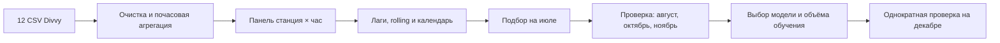
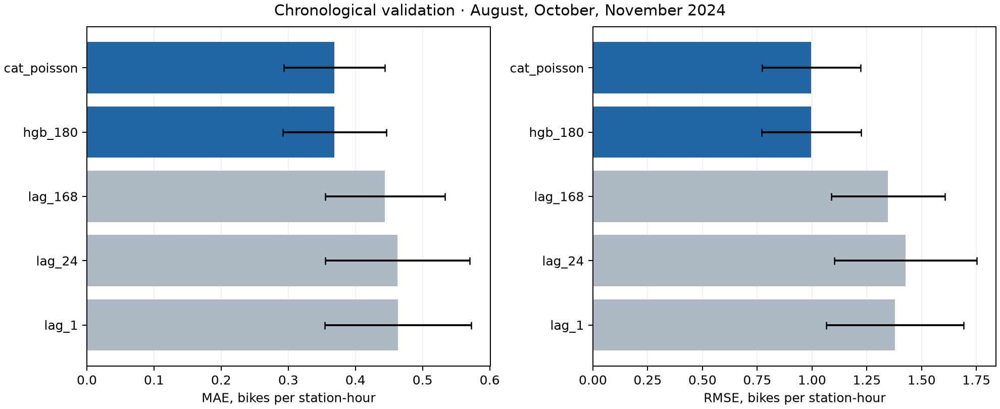

# Urban Mobility Optimization

### Почасовой прогноз отправлений с велостанций Divvy · Chicago, 2024

> **Итог:** выбранный `HistGradientBoostingRegressor` достиг **MAE 0,1835** и **RMSE 0,4856** на декабрьском holdout. По MAE это на **10,5% лучше** лучшего лагового прогноза на том же периоде. При сравнении моделей на одинаковых выборках он обучался примерно **в 11,8 раза быстрее CatBoost** при практически равном качестве.

**Данные:** 12 месячных файлов Divvy за 2024 год · **Горизонт:** следующий час · **Единица прогноза:** число стартов поездок на станции за час · **Валидация:** три временных периода + отдельный декабрьский holdout.

---

## 1. Задача и результат

В исходной версии проекта данные признаков заканчивались в мае, хотя CSV были доступны за весь год. Также цель была сдвинута на следующий час, а лаги считались относительно предыдущего: `demand_lag_1` фактически отставал от целевого часа на два часа. Я пересобрал данные за январь–декабрь и выровнял признаки. Теперь строка с временем `t` предсказывает количество отправлений **в час `t`**, используя только завершённые часы до `t`.

| Показатель | Итог |
| --- | ---: |
| Ненулевые станция-часы после очистки поездок | 1 797 080 |
| Строки обучающей панели после дополнения нулевых часов и прогрева лагов | 10 360 622 |
| Станции в панели | 1 678 |
| Строки в финальном обучении | 2 000 000 из 9 490 831 доступных до декабря |
| Декабрьских строк для проверки | 869 791 |

Важное определение: это **почасовой прогноз с обновлением фактического спроса**. Валидация предполагает, что после каждого часа становится известно число поездок за него. Результат не описывает пакетный прогноз сразу на 14 дней без новых наблюдений.

## 2. Как устроен эксперимент



**Формирование данных.** CSV читаются порциями; поездки с отсутствующим ID станции, некорректными датами и длительностью вне `(0; 24 часа]` исключаются. Старты группируются по станции и часу. В панели часы без зарегистрированных стартов имеют цель `0`. Станция появляется после первой зарегистрированной поездки; после 30 дней без поездок она временно исключается по правилу, которое использует только прошлые наблюдения. Первые 169 часов каждой станции нужны для заполнения лагов и не оцениваются.

**Признаки.** Используются спрос за 1, 2, 3, 24, 25, 48, 168 и 169 часов до цели; скользящие средние за 3, 24 и 168 часов и стандартное отклонение за 24 часа, рассчитанные после `shift(1)`; час, день недели, месяц, выходной и циклические представления времени. Координаты берутся из первой наблюдаемой поездки станции. Для CatBoost дополнительно проверялся категориальный ID станции.

**Разделение по времени.** Подбор четырёх ограниченных конфигураций выполнен на 1–14 июля с обучением только на предшествующих данных. Лучшие конфигурации двух семейств проверены на 1–14 августа, 1–14 октября и 1–14 ноября. На каждом шаге доступно только прошлое; 800 тыс. строк обучения выбираются случайно **внутри этого прошлого**, а validation оценивается целиком. Декабрь не использовался для подбора или выбора модели.

## 3. Качество и стоимость обучения



*Столбцы — средние метрики трёх validation-периодов, усики — стандартное отклонение. Для сравнения семейств использовалось по 800 тыс. исторических строк на fold.*

| Модель | CV MAE ↓ | CV RMSE ↓ | Обучение на fold ↓ |
| --- | ---: | ---: | ---: |
| CatBoost, Poisson | **0,3688 ± 0,0752** | 0,9964 ± 0,2245 | 87,8 с |
| **HistGradientBoosting** | 0,3689 ± 0,0769 | **0,9960 ± 0,2271** | **7,4 с** |
| Lag 168 | 0,4439 ± 0,0893 | 1,3474 ± 0,2601 | — |
| Lag 24 | 0,4625 ± 0,1076 | 1,4276 ± 0,3253 | — |
| Lag 1 | 0,4632 ± 0,1089 | 1,3786 ± 0,3129 | — |

Показатель выбора: `mean(MAE) + 0,25 × std(MAE) + 0,05 × mean(RMSE)`. Среди моделей в пределах 1% от лучшего значения выбирается самая быстрая в обучении. Разница среднего MAE между двумя лидерами — около **0,0001**, поэтому выбран HistGradientBoosting. Его средний CV MAE на **16,9% ниже** лучшего лагового baseline (`lag_168`).

Затем отдельно проверен объём обучения выбранного семейства на тех же временных периодах:

| Строк на fold | Средний MAE ↓ | Средний RMSE ↓ | Время обучения ↓ |
| ---: | ---: | ---: | ---: |
| 800 тыс. | 0,3689 | 0,9960 | 7,4 с |
| **2 млн** | **0,3666** | **0,9878** | **17,2 с** |
| 4 млн | 0,3663 | 0,9823 | 33,5 с |

Переход на 2 млн строк даёт заметный выигрыш; последующее удвоение улучшает MAE примерно на 0,1% ценой почти двукратного времени. Для финальной модели выбран лимит **2 млн строк**.

## 4. Независимая проверка: декабрь 2024

| Модель | MAE ↓ | RMSE ↓ | R² ↑ |
| --- | ---: | ---: | ---: |
| **HistGradientBoosting, 2 млн строк** | **0,1835** | **0,4856** | **0,4891** |
| Lag 24 | 0,2051 | 0,6749 | 0,0129 |
| Lag 1 | 0,2063 | 0,6753 | 0,0120 |
| Lag 168 | 0,2161 | 0,7053 | −0,0777 |

Относительно лучшего декабрьского baseline (`lag_24`) MAE ниже на **10,5%**, RMSE — на **28,1%**. Сегментный анализ показывает, где эта прибавка особенно важна:

| Сегмент декабря | Строк | MAE модели | MAE `lag_24` | Изменение |
| --- | ---: | ---: | ---: | ---: |
| Загруженные станции¹ | 124 248 | **0,6532** | 0,7978 | **−18,1%** |
| Часы пик² | 253 626 | **0,2669** | 0,3070 | **−13,1%** |
| Все станция-часы | 869 791 | **0,1835** | 0,2051 | **−10,5%** |
| Нулевой спрос | 781 185 | 0,0927 | **0,0868** | +6,8% |

¹ Верхние 10% станций по среднему спросу в обучающем прошлом. ² Часы 07–09 и 16–19. На нулевых часах модель чаще выдаёт небольшое положительное значение, поэтому её MAE здесь выше простого `lag_24`. Это честный компромисс ради улучшения на активных станциях. Декабрьский WAPE равен **1,071**: при малом зимнем объёме спроса относительная ошибка остаётся высокой даже при низкой абсолютной.

## 5. Воспроизведение

Из корня проекта в PowerShell, с установленным Python 3.12:

```powershell
python -m venv .venv
.\.venv\Scripts\python.exe -m pip install -r requirements.txt
.\.venv\Scripts\python.exe src\data\downloader.py
.\.venv\Scripts\python.exe src\features\build_demand.py
.\.venv\Scripts\python.exe src\features\create_features.py
.\.venv\Scripts\python.exe src\forecasting\train.py --max-train-rows 800000 --tune-rows 400000 --threads 8
.\.venv\Scripts\python.exe src\forecasting\training_size_experiment.py --rows 2000000
.\.venv\Scripts\python.exe src\forecasting\training_size_experiment.py --rows 4000000
.\.venv\Scripts\python.exe src\forecasting\train.py --reuse-results --final-train-rows 2000000
.\.venv\Scripts\python.exe -m unittest discover -s tests -v
```

Загрузчик получает 12 исходных файлов `data/raw/divvy/2024??-divvy-tripdata.csv`. Они и производные parquet не добавляются в Git из-за объёма; при уже загруженных данных шаг скачивания можно пропустить, а `build_demand.py` поддерживает `--raw-dir` для другого расположения. Сохранённая модель и CSV-отчёты находятся в `results/`. В этом запуске **3 из 3** тестов прошли.

| Артефакт | Содержание |
| --- | --- |
| [`results/reports/model_comparison.csv`](results/reports/model_comparison.csv) | Средние CV-метрики и разброс |
| [`results/reports/fold_metrics.csv`](results/reports/fold_metrics.csv) | Метрики каждого периода и сегмента |
| [`results/reports/training_size_experiment.csv`](results/reports/training_size_experiment.csv) | Проверка 800 тыс., 2 млн и 4 млн строк |
| [`results/reports/holdout_metrics.csv`](results/reports/holdout_metrics.csv) | Декабрь и сегменты |
| [`results/reports/selected_model.json`](results/reports/selected_model.json) | Параметры, признаки и правило выбора |
| [`results/models/best_model.joblib`](results/models/best_model.joblib) | Модель, обученная до 1 декабря |

## 6. Ограничения и следующий шаг

- Наблюдаемые поездки могут занижать реальный спрос, когда на станции нет доступных велосипедов. Для полноценного ребалансирования потребуются данные об остатках, прибытиях и вместимости.
- 30-дневное правило активности станции — эвристика без официального календаря открытия и закрытия.
- Текущая проверка относится к горизонту **один час**. Для прогноза на день вперёд нужна отдельная схема, которая не подставляет фактические значения промежуточных часов.
- Распределение ошибок заметно меняется по сезонам; сравнение только на одном случайном split было бы ненадёжным. При наличии новых лет стоит проверить перенос модели между годами и добавить погодные признаки с учётом времени их фактической доступности.

## Источники

Методика временной валидации и лаговых признаков опирается на [пример scikit-learn](https://scikit-learn.org/stable/auto_examples/applications/plot_time_series_lagged_features.html), циклические признаки — на [документацию scikit-learn](https://scikit-learn.org/stable/auto_examples/applications/plot_cyclical_feature_engineering.html). В качестве близкого практического сравнения изучен [Divvy bike rebalancing на GitHub](https://github.com/rishi-kumar0208/divvy-bike-rebalancing), где также используются станционная панель, исторические признаки и категориальный ID. Пространственную и временную неоднородность спроса обсуждают [Feng et al. (2024)](https://doi.org/10.1145/3690388). Подробные заметки: [RESEARCH.md](RESEARCH.md).
